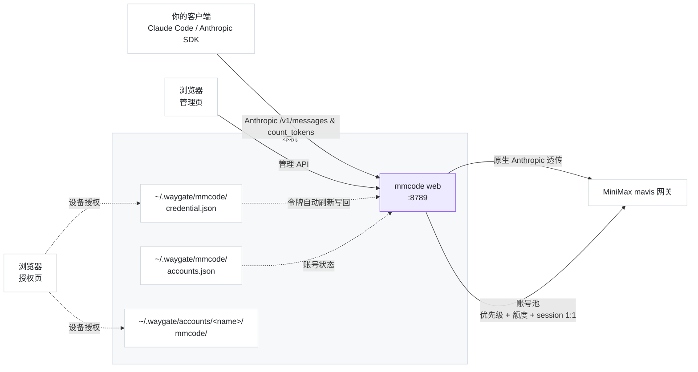

# waygate-mmcode

<div align="center">

**途关 · MiniMax Code 反代**

把 MiniMax Code 客户端的订阅，变成你自己的本地 API

[](https://www.npmjs.com/package/waygate-mmcode)


[快速开始](#快速开始) · [多账号与管理页](#多账号与-web-管理页) · [Docker 部署](#docker-部署) · [凭证互斥](#凭证互斥必读) · [客户端配置](#客户端怎么填) · [工作原理](#工作原理) · [常见问题](#常见问题) · [相关项目](#相关项目)

</div>

---

> [!CAUTION]
> **凭证互斥（必读）**：MiniMax 的 refresh token 是**一次性**的，且**同一账号同时只有一个有效会话**。
> 本工具与官方客户端（桌面端**或**官方 `mcode` CLI）登录**同一个账号**会**互相踢下线**。
>
> **解决**：给本工具配**专用账号**（与日常使用的账号分开注册一个即可）——
> 跑 `mmcode login`（浏览器授权）→ 此后**永远不在那个账号上登录任何官方客户端**。
>
> 备了**多个**专用账号？本工具会**自动切换**：某个号被顶掉时自动换下一个，服务不中断。

**用官方 OAuth 设备授权登录，在本机起一个纯 Anthropic 原生兼容反代** ——
Claude Code、Anthropic SDK、任何支持自定义 `ANTHROPIC_BASE_URL` 的工具，都能直接用你的订阅额度。

- **零配置接入** —— 一条命令起服务，打印出「代理地址 + 密钥 + 模型 ID」
- **浏览器授权登录** —— `mmcode login` 打印一个链接，点开授权即可；**不需要装桌面客户端**，
  服务器上也能自助登录（这正是它相比「读本机登录态」方案的用处）
- **原生 Anthropic 透传** —— 支持 `POST /v1/messages`（含流式 SSE、`thinking`、`cache_control`）与 `POST /v1/messages/count_tokens`（以及去 `/v1` 前缀的 `/messages`、`/messages/count_tokens`），零协议翻译损耗
- **多账号 + 智能调度** —— 账号按**优先级分层**、同层随机分配；**按 session 1:1 粘住账号**（`count_tokens` 与同会话对话落在同一账号）保住上游缓存，额度耗尽时可无缝滑动
- **用量洞察面板** —— 看清**每个账号**分别烧了多少 token（输入 / 输出 / 缓存命中），按模型与按天拆分
- **自动签到可随机化** —— 国内 / 海外**两套独立计划**（各带时区），签到时刻可在设定时间**前后随机**，每个账号各一个落点
- **Web 管理页** —— 浏览器里登录、授权、签到、看状态；密钥保护，状态**落盘持久**
- **Docker 一键部署** —— 一个容器、一个端口，反代与管理页都在里面
- **只在本机转** —— 写 `~/.waygate/`、本机转发；不向任何第三方上传数据

## 快速开始

```bash
# 全局安装
npm i -g waygate-mmcode

# 登录：打印授权链接（浏览器打开、用你的 MiniMax 账号完成授权）
mmcode login

# 启动
mmcode
```

`mmcode login` 会**原地等你 2 分钟** —— 你在浏览器点完授权，终端**自动继续**，无需再来一次。
若超过 2 分钟，它会提示你用 `mmcode login-poll` 续跑（设备码 5 分钟内有效）：

```
请用浏览器打开下面的链接完成授权（用你的 MiniMax 账号）：

  https://account.minimax.cn/oauth-authorize?user_code=Z2MD-MW5P

  短码：Z2MD-MW5P（链接已含，直接打开即可）

授权完成后本终端会**自动继续**（最多等 120 秒）。

✓ 登录成功 → ~/.waygate/mmcode/credential.json
```

```
途关 · MiniMax Code 反代 v0.6.0

凭证    ✓ access 有效约 187 分钟（账号 01a0d156…）
上游    https://agent.minimax.cn  (Anthropic 原生透传)
代理    http://127.0.0.1:8788      （Anthropic 客户端如 Claude Code 填此地址，会自动补 /v1）
密钥    sk-mmcode-1a2b3c4d5e6f7a8b9c0d1e2f3a4b5c6d

模型 ID（填进你的客户端）：
  MiniMax-M3
  MiniMax-M3.1-Flash-Preview
  MiniMax-M2.7
  MiniMax-M2.7-highspeed

把上面的「代理地址 + 密钥」填进 Claude Code 或 Anthropic SDK 即可。
端点：POST /v1/messages · POST /v1/messages/count_tokens · GET /v1/models
按 Ctrl+C 停止。
```


**要求**：Node.js ≥ 20；**不需要**装 MiniMax Code 桌面客户端（登录走浏览器授权）。

## 多账号与 Web 管理页

`mmcode web` 起一个**统一服务**：同一个端口上同时提供**反代**、**管理页**和**管理 API**。

```bash
mmcode web                # 默认 127.0.0.1:8789
mmcode web --host 0.0.0.0 --port 8789
```

```
  管理页        http://127.0.0.1:8789/
  反代地址      http://127.0.0.1:8789    （Anthropic 客户端填此地址，勿带 /v1）
  健康检查      http://127.0.0.1:8789/healthz

  ⚠️  已生成管理密钥（首次启动自动生成，仅此一次明文显示）：
     adm-mmcode-fec39de54700c82229e5ca893a13505f
     已保存到 ~/.waygate/mmcode/admin.json（权限 0600）
```

### 管理密钥

- **未设置则自动生成一个**（首次启动时打印到日志里，之后只打码显示）。
- 保存在 `~/.waygate/mmcode/admin.json`（**0600**），重启不丢。
- **可修改**：管理页「设置」里改 —— 必须提供**当前正确的旧密钥**；改完**所有旧会话立刻失效**。
- 管理密钥与**反代入站密钥**（`~/.waygate/mmcode/key`）是**两把不同的钥匙**：
  前者进管理页，后者给 Claude Code / Anthropic SDK 用。

> 浏览器里**不存密钥**：登录时把密钥交给服务端换成 HttpOnly 会话 Cookie，密钥本身不落 localStorage。

### 客户端密钥管理（给客户端用的 token）

客户端 token 是**长期凭据**（填在 Claude Code / Anthropic SDK / 脚本里）。一把钥匙用久了有实际麻烦：

- **泄露后无法精确吊销** —— 只能整体换掉，把所有客户端一起打断；
- **无法区分用途** —— 不知道哪把是哪台机器；
- **不知道谁在用** —— 没有使用记录，轮换全靠猜。

所以管理页支持**多把独立密钥**：

| 操作 | 说明 |
| :--- | :--- |
| 生成新密钥 | 填用途名（如「Claude Code 笔记本」），生成后**当场完整显示**，一键复制 |
| 复制 | 密钥行、接入信息块都有「复制」按钮，**点击即复制**（地址与密钥各一个） |
| 显示 / 隐藏 | 默认打码（`sk-mmcode-7ef7…6dc8`），可展开看全文 |
| 启用 / 停用 | 暂时冻结，可恢复 —— 比吊销轻 |
| 轮换 | 保留名字与备注，**换一把新的**，旧值立即失效 |
| 吊销 | 彻底删除，用它的客户端立刻开始 401 |

密钥清单落在 `~/.waygate/mmcode/keys.json`（0600）。**主密钥**同时写一份到
`~/.waygate/mmcode/key`（core 的约定位置）—— 既有客户端配置**不用改**；
吊销主密钥时会**换一把新的顶上**（吊销 = 换掉，不是留空）。

命令行也能管：

```bash
$ mmcode keys
客户端入站密钥

 ★ 默认密钥  [启用]  sk-mmcode-7ef7…6dc8  (primary)
     sk-mmcode-7ef772257e523b446cf532336d036dc8
   上次使用 2026/11/8 03:02:28 · 创建于 2026/11/8 02:31:49 · id primary

★ = 主密钥（core 的 key 文件指向它）

$ mmcode keys new "Claude Code 笔记本"
$ mmcode keys rotate <id>
$ mmcode keys revoke <id>
```

> **多把密钥的鉴权直接集成在统一反代处理器中**：注册表里任意一把**启用且未过期**的密钥均可通过
> `x-api-key` 或 `Authorization: Bearer <key>` 鉴权，`serve` 与 `web` 共用同一套原生 Anthropic 透传引擎，无需内部环回。

### 账号管理页能做什么

| 能力 | 说明 |
| --- | --- |
| 新增账号 | 填名字 + 选区域（国内 / 海外），即建即用 |
| OAuth 授权登录 | 点「登录」拿到短码与授权链接，**在浏览器完成授权，页面自动继续** |
| 状态一览 | 登录态、令牌剩余、健康状态、冷却中、额度冻结、签到结果、积分余额 |
| 签到 / 积分 | 点一下就代签，**不用为了签到去登客户端**（登客户端反而会踢掉反代） |
| 自动签到开关 | 可针对单个账号独立**开启 / 停用自动签到**（不影响反代调度），表格实时展示签到开启状态 |
| **签到计划** | 国内 / 海外**两套独立计划**：各自的签到时间、**随机窗口**、**时区**（见下节） |
| 启用 / 停用 | 停用的账号保留配置，但不参与调度 |
| 删除账号 | 连同令牌文件一起清掉 |
| 调度模式 | 「最大缓存（会话不迁移）」或「平衡（额度耗尽可滑动）」 |
| 优先级分层 | 给账号设优先级层（数字越小越优先），同层随机分配 |
| 额度阈值 | 余额低于多少积分就**冻结**该账号（不再参与调度） |
| **用量洞察** | 各账号的 token 消耗（输入 / 输出 / 缓存命中 / **缓存命中率**）、按模型与按天拆分 |
| **请求详情** | 横向三栏：**请求**（入站内容）/ **中转**（上游地址 + 实际发往上游的 Anthropic 请求）/ **输出**（回复 + 输出详情 + 首字符时间） |
| **请求列表带来源** | 测活与预热**同样会打到上游**，它们也会进请求列表，并用**来源**标记区分（反代 / 测活 / 预热），可按来源筛选 |
| **客户端密钥** | 多把密钥的生成 / 复制 / 停用 / 轮换 / 吊销（见下节） |
| 修改管理密钥 | 需旧密钥校验 |

### 账号状态是**持久**的

分两层落盘（都不进版本库）：

| 内容 | 位置 |
| --- | --- |
| 令牌（access / refresh） | `~/.waygate/accounts/<name>/mmcode/credential.json`（0600） |
| 运营状态（健康、冷却、优先级、额度冻结、签到记录、余额快照、启用与否） | `~/.waygate/mmcode/accounts.json` |
| 用量台账（各账号 token 消耗） | `~/.waygate/mmcode/insights.json` |

**冷却是持久化的** —— 某个号刚被顶掉，服务重启后依然记得，不会又去撞一次 401。
**额度冻结同样持久**，余额刷新后自动解冻。

### 自动签到：两套计划 + 随机窗口

MiniMax 的国内站与海外站是**两套独立服务**，账号也分属两区 —— 所以签到计划也分两套，
在管理页「设置 → 自动签到与自动刷新调度」里各配各的：

| | 国内账号（cn） | 海外账号（global） |
| --- | --- | --- |
| 签到时间 | 如 `08:30` | 如 `08:30` |
| 随机窗口 | 如 `30` | 如 `30` |
| 时区 | 默认 `Asia/Shanghai` | 默认 `America/New_York`（美国东部） |

- **随机窗口 = 0** → **固定时间**，就在那一刻签，一秒不差；
- **随机窗口 = N** → 在 **[时间-N, 时间+N]** 里给**每个账号各挑一个随机时刻**。
  例：设 `08:30`、窗口 30 分钟 ⇒ 实际落在 **08:00 ~ 09:00**，**向前向后各半概率**。

为什么要随机：所有账号每天挤在同一秒打同一个上游，既容易撞限流，
也等于给上游画了一张「机器行为」的指纹。随机时刻由
`hash(安装种子 + 日期 + 账号名)` 派生 ——
**当天固定**（重启不漂移）、**跨天不同**（不规律）、**账号之间错峰**（不挤在一起）。

调度器用**精确唤醒**（直接睡到下一个该签的那一刻）而不是轮询 ——
轮询粒度 30 分钟会把所有签到挤到窗口边界，随机就白随机了；
另有 30 分钟一次的兜底巡检，防止精确唤醒被漏掉。

> **两区的「今天」不是同一天** —— 「今天签没签过」按账号所属区域的时区判断。
> 错过窗口（比如服务停了一上午）会**补签**：晚签比断签好。
>
> 随机种子写在 `~/.waygate/mmcode/scheduler-config.json` 里（连同签到计划），
> 删掉这个文件会重新生成 —— 当天的随机时刻随之改变。

### 账号调度：优先级 + 额度 + session

因为 MiniMax「同一账号只能有一个有效会话」，**多账号是唯一解法**。
调度不看「当前是哪个账号」，只看三件事：**优先级**、**额度**、**session 归属**。

**① 优先级分层**

每个账号有一个优先级层（数字越小越优先，0 是最高层）。新会话分配到
「**最高层里还有可用账号**」的那一层；这一层全被冻结 / 冷却了才下沉到下一层。
**同一层之内没有先后顺序** —— 可用账号之间**随机分配**（不是轮询：轮询会让第 N 个会话
固定落在第 N 个号上，把某个号的缓存优势全占了）。

**② 额度冻结**

上游**不回报单次请求消耗**，所以额度只能问账户级积分账本：

- 后台每 5 分钟刷新各账号余额，**低于阈值**（默认 100 积分，可配）就**冻结**该号 —— 不参与调度；
- 上游回 **429** 同样立即视为额度耗尽并冻结；
- 余额回到阈值以上**自动解冻**。

**③ session 归属（一对一绑定与两种模式）**

「同一 session 的请求永远待在同一个账号上」—— 不仅多轮对话不切换账号以保住上游提示词缓存，
**新会话开始前先发起的 `POST /v1/messages/count_tokens` 也会与随后的 `POST /v1/messages` 绑定到同一个账号**，确保同一会话全程一对一落在同一账号上。session 的识别：

- 客户端显式给 `x-session-id` / `x-session` / `x-conversation-id` / `x-chat-id` 头、body 的 `session_id` / `metadata.session_id`，或 Claude Code `metadata.user_id` 中的 `__session_<id>` → **优先采用**；
- 没有则按「入站密钥 + 模型 + 首条用户消息」哈希推导（`count_tokens` 与对话首轮及后续重发历史的首条用户消息与模型一致，因而命中同一 `sessionKey`）。

| 模式 | 行为 |
| --- | --- |
| **最大缓存**（默认） | session 绑定某账号后**永不迁移** —— 哪怕该账号额度耗尽也不换号（会明确报错，让你补额度或重新授权） |
| **平衡** | 绑定期间行为同最大缓存；绑定账号**额度耗尽 / 不可用时无缝滑到**别的可用账号，绑定随之更新 |

**④ 失败归类**（两种模式都适用）

1. 上游 **401 / 403**（凭证被别处登录顶掉）→ 标记失效、冷却 30 分钟；
2. 上游 **429** → 冷却 60 秒**并冻结额度**；
3. **5xx / 网络抖动不换号** —— 那是上游整体的问题，换号只会把所有号都标记成坏。

> **v1 → v2 迁移**：旧的「粘性当前账号 + 轮询策略」两个概念整体消失，
> `accounts.json` 自动升到 v2（账号继承同一优先级 = 同层随机分配），无需手工处理。

## Docker 部署

从 GHCR 拉取已发布镜像（推荐，无需本地构建）：

```bash
docker compose pull && docker compose up -d
```

从源码本地构建：

```bash
cd ~/项目/waygate-mmcode
docker compose up -d --build

# 首次启动：日志里会打印管理密钥明文
docker compose logs -f mmcode

# 随时再查（状态目录与宿主机共用）
cat ~/.waygate/mmcode/admin.json
```

### 镜像标签与版本

版本由 **Git tag** 管理（`vX.Y.Z`），推送 tag 即自动发布镜像：

| 标签 | 含义 |
| --- | --- |
| `ghcr.io/goldtest/mmmcode:X.Y.Z` | 正式版（由 `vX.Y.Z` tag 触发） |
| `ghcr.io/goldtest/mmmcode:latest` | 指向最新正式版 |
| `ghcr.io/goldtest/mmmcode:main-<sha>` | 主分支的临时构建，不覆盖 `latest` |

要**固定版本**部署，把 `docker-compose.yml` 里的 `image` 改成具体版本标签：

```yaml
image: ghcr.io/goldtest/mmmcode:0.6.0
```

- **一个端口**（8789）：反代、管理页、管理 API 全在里面。
- **非 root 运行**（以宿主用户身份），带 `/healthz` 健康检查，`restart: unless-stopped` 开机自起。
- 默认只绑 `127.0.0.1`；要对外暴露改成 `"8789:8789"`，
  但请注意**反代入站密钥同样有效** —— 公网部署请在前面套一层 TLS + 防火墙。

### ★ 状态目录为什么是「绑定挂载」而不是命名卷

`docker-compose.yml` 把宿主机的 `~/.waygate` **直接挂进**容器（`/data/.waygate`），
容器以宿主用户身份运行（uid/gid 写在 `.env` 里），因此：

- 容器与宿主机的 `mmcode` CLI 共用**同一份**凭证 —— 不存在第二份副本；
- 宿主机 `~/.waygate` 的文件权限不用改，容器照样能读写。

> [!IMPORTANT]
> **绝不能**把 `~/.waygate` 拷一份进命名卷。
> MiniMax 的 refresh token 是**一次性**的：两份拷贝各自刷新，
> 后刷的那份会把先刷的**顶掉**（表现为账号突然 401、被误判失效）。
> 凭证**只能有一份**。

### 自动签到在 Docker 模式下怎么跑

宿主机原来的 `auto_checkin.sh` **不能**再用 —— 它会在宿主机上另起进程刷令牌，
与容器内存里那份凭证抢 refresh token（一次性），把好账号误判成失效。

所以签到改为**通过容器 API 触发**（`docker_checkin.sh`），凭证生命周期由容器进程独占维护：

```bash
# 手动跑一次
./docker_checkin.sh

# 或让 systemd 定时器每天 09:30 自动跑（单元已指向 docker_checkin.sh）
systemctl --user start mmcode-checkin.service
```

签到结果照旧写进 `~/.waygate/mmcode/checkin.log`。

> 旧的 `auto_checkin.sh`（在宿主机上直接刷令牌）**检测到容器在跑就会拒绝执行**，
> 并在日志里指向 `docker_checkin.sh` —— 免得有人误用又把令牌竞态搞回来。

> `mmmcode.sh`（早期的多账户命令行包装）也已在帮助里标注**过时**：
> 多账号的登录/签到/密钥管理现在都在 `mmcode web` 的网页上做，状态统一持久化。

### 令牌刷新会「自愈」

若宿主机上的 CLI 抢先刷新了令牌（写回了同一个 `credential.json`），
容器内存里那份 refresh token 就作废了。刷新失败时本工具会**重读文件比对**，
发现 refresh token 变了就用新的那份重试一次 —— 不会误判账号失效。

### 不用 compose 也能直接跑

```bash
docker build -t waygate-mmcode .
docker run -d --name mmcode \
  -p 127.0.0.1:8789:8789 \
  -v "$HOME/.waygate:/data/.waygate" \
  -u "$(id -u):$(id -g)" \
  waygate-mmcode
```

## 凭证互斥（必读）

MiniMax 的会话机制决定了**同一个账号同时只有一个有效会话**。这意味着：

| 你做的事 | 后果 |
| --- | --- |
| 本工具在跑 → 你登录官方客户端 / `mcode` CLI（同一账号） | **本工具失效**，需重跑 `mmcode login` |
| 官方客户端在用 → 你启动本工具（同一账号） | 官方客户端被踢下线 |

**正确姿势**：注册一个专用账号，**只用它跑 `mmcode login`**（在浏览器里授权），
此后**永远不在那个账号上登录任何官方客户端**。日常账号照常用客户端，两边互不干扰。

> **备多个专用账号更好用**：反代会**自动切换** —— 某个号被顶掉（401）时自动换下一个，
> 服务不中断。见[多账号与 Web 管理页](#多账号与-web-管理页)。

> ⚠️ **走设备授权并不会解除互斥**。它改变的是「在哪台机器上登录」（服务器也能自助授权），
> 不是「能有几个会话」。同一个账号只要在别处登过一次，本工具手里的 refresh token 立刻作废。

## 命令

```bash
mmcode               # 启动反代（同 mmcode serve），打印模型 ID 与代理地址
mmcode web           # 统一服务：反代 + 管理页 + 管理 API（同一端口，默认 8789）
mmcode models        # 只列出模型 ID（不起服务）
mmcode doctor        # 自检：端口 / 凭证 / 令牌刷新 / 上游连通
mmcode login         # 登录（浏览器授权一次；等 2 分钟无授权则改用 login-poll）
mmcode login-poll    # 完成登录：浏览器授权后取票（`login` 等待超时也用它）
mmcode accounts      # 列出所有账号及其状态（优先级 / 额度 / 健康 / 冷却 / 签到）
mmcode keys          # 管理客户端用的入站密钥（列出 / 生成 / 轮换 / 吊销）
mmcode checkin       # 每日签到领积分（用本工具令牌代签，无需开客户端）
mmcode credits       # 查积分账本（剩余 / 已消耗 / 累计，精确到 0.01）
```

> `mmcode checkin` / `mmcode credits` 可带账号名：`mmcode checkin haiwai1`。
> 不带则作用于第一个可用账号。

**多账号速览**：

```bash
$ mmcode accounts
MiniMax Code 账号池

 ✓ default     [国内] 优先级 0  已登录  健康:healthy 签到:claimed
 ✓ haiwai1     [国内] 优先级 0  已登录  健康:healthy 余额:820.5
 ✗ rjh521      [海外] 优先级 1  未登录  健康:unknown
 ✓ zhanghx101  [海外] 优先级 0  已登录  健康:healthy 冷却至 2026/11/8 3:05:00 ❄冻结（上游 429：quota exceeded）

模式：最大缓存模式（可用 3/4）  最小可用积分：100
优先级数字越小越优先；同层账号随机分配。
```

**签到与积分**（MiniMax Code 专属）：

```bash
$ mmcode checkin
✓ 签到成功 +400 积分（连续第 4 天）

$ mmcode credits
MiniMax Code 积分账本

剩余    4188.65
已消耗  6611.35
累计发放 10800
最近到期 2026-10-14

批次明细（17 笔）：
  +400  剩 400  用 0  到期 2026-11-12
  +800  剩 188.65  用 611.35  到期 2026-11-05
  …（还有 7 笔）

注：上游不回报单次请求消耗，以上为账户级批次累计（精确到 0.01）。
```

> **为什么能代签**：签到接口用的就是本工具已在维护的 access token。所以你**不需要为了签到去登录客户端**
> ——（登录客户端反而会踢掉本工具）。加 `--json` 可得到机器可读输出，便于脚本/定时任务。

| 参数 | 说明 |
| --- | --- |
| `--port <n>` | 监听端口（默认 8788） |
| `--host <addr>` | 监听地址（默认 `127.0.0.1`） |
| `--key <sk-…>` | 指定入站密钥（默认自动生成并缓存） |
| `--json` | 机器可读输出 |
| `--verbose` | 打印每个请求的路由日志 |

## 客户端怎么填

**Claude Code**

```bash
export ANTHROPIC_BASE_URL="http://127.0.0.1:8788"
export ANTHROPIC_API_KEY="sk-mmcode-…"
export CLAUDE_CODE_USE_BEDROCK="false"
```

（若使用 `mmcode web` 统一服务，将端口改为 `8789`；**不要**在 `ANTHROPIC_BASE_URL` 末尾带 `/v1`，Anthropic SDK 与 Claude Code 会自动补 `/v1`。）

**Anthropic SDK / curl**

- Base URL：`http://127.0.0.1:8788`（或统一服务 `http://127.0.0.1:8789`）
- API Key：启动时打印的 `sk-mmcode-…`（支持 `x-api-key` 或 `Authorization: Bearer <key>`）
- 模型：模型 ID（如 `MiniMax-M3`、`MiniMax-M3.1-Flash-Preview`）

暴露的端点（均兼容去 `/v1` 前缀）：

- `POST /v1/messages`（及 `/messages`）—— 原生 Anthropic 消息接口，完整透传 SSE、`thinking`、`cache_control` 与 `tools`
- `POST /v1/messages/count_tokens`（及 `/messages/count_tokens`）—— 原生 Anthropic Token 计数透传，并与同会话对话一对一绑定同一账号
- `GET /v1/models`（及 `/models`）—— 可用模型列表
- `GET /healthz` —— 健康检查

> 本工具仅支持 **Anthropic 协议**，不再支持 OpenAI `/v1/chat/completions`（调用将返回 404 Anthropic `not_found_error`）。

支持流式（SSE）与非流式（`stream: false`）两种响应模式。

## 工作原理

- **凭证**：走 MiniMax **官方 OAuth 2.0 设备授权**（RFC 8628 + PKCE S256，端点 `account.minimax.cn/oauth2/device/code`）。
  `mmcode login` 打印授权链接，你在浏览器完成授权后取票，写到 `~/.waygate/mmcode/credential.json`（0600）。
  **不读本机客户端文件、不解密任何东西**；参数与官方 `mcode` CLI 同一个 OAuth client（`mcode-public`）。
- **令牌生命周期**：access token（`mmoat_`）寿命短（约 1–4 小时），到期前 2 分钟自动刷新；refresh token（`mmort_`）刷新后会被上游**轮换**，本工具自动写回本地。
- **模型清单**：上游的清单端点是 `/mavis/api/v1/models`（**无需鉴权**即可读）—— 本工具**真拉取**，失败时回落内置清单（4 个模型）。
- **多账号**：每个账号一套独立令牌（`accounts/<name>/mmcode/`）+ 一条运营状态（`accounts.json`）。
  `AccountPool` 负责选号（**优先级分层 + 同层随机 + 额度冻结 + session 1:1 绑定**），
  **冷却与冻结状态落盘**，重启不丢。
- **用量洞察**：适配器从原生 Anthropic 响应（JSON 与 SSE `message_start` / `message_delta`）里摘出权威 usage（含 `cache_read_input_tokens` / `cache_creation_input_tokens`）记进 `insights.json` —— 各账号的
  token 消耗（输入 / 输出 / 缓存命中）按模型、按天拆分，并给出**缓存命中率**
  （命中 token / 输入 token），管理页与请求详情里都能看到；`count_tokens` 请求留痕在请求详情中，不计入用量台账以免虚增消耗。
- **原生直通反代**：`mmcode serve` 与 `mmcode web` 共用同一套原生 Anthropic 透传处理器，无内部环回、无协议往返翻译，完整保留 `system` blocks、`cache_control`、`thinking` 与 `count_tokens`。



> [!NOTE]
> **单次请求的积分消耗上游不回报** —— MiniMax 的聊天响应只有 token 数，没有单次费用字段。
> 积分余额以[官方客户端](https://www.minimax.io)的账本页为准（精确到 0.01）。

## 常见问题

**要装 MiniMax Code 客户端吗？** **不要。** 登录走浏览器授权（`mmcode login`），任何能开浏览器的机器都行 —— 服务器上也能自助登录。

**令牌被顶掉了怎么办？** 有人用同一账号登录了官方客户端或 `mcode` CLI —— 本工具被踢。跑一次 `mmcode login` 重新授权即可（确保此后没人再登那个账号）。

**配多个号就不用管顶号了吗？** 不用管，但要**都授权给本工具**。多号的价值是：某个号被顶掉时**自动换下一个**，反代不中断。
每个号仍需**各自**跑一次 `mmcode login`（或在管理页里逐个授权）——
它们是**独立会话**，互相之间不共享 refresh token。

**管理页的密钥忘记了？** `cat ~/.waygate/mmcode/admin.json`（Docker 模式下状态目录与宿主机共用，同一条命令即可）。
实在找不回就删掉这个文件 —— 下次启动会**自动生成一把新的**。

**管理密钥和反代密钥能混用吗？** **不能**，是两把不同的钥匙：管理密钥进管理页，反代入站密钥给客户端调模型。

**`mmcode web` 和 `mmcode serve` 有什么区别？** `serve` 是**纯反代**（老行为不变，8788 端口）；`web` 是**统一服务**（8789 端口），
反代 + 管理页 + 管理 API 都在上面。两者共用同一份账号状态，可以只开一个。

**网页能放到公网吗？** 技术上可以，但**反代入站密钥等于模型额度**，管理页虽有密钥保护，
公网暴露仍建议在前面套 TLS 反代 + IP 白名单/防火墙。

**会不会把我的令牌上传？** 不会。全程只在本机读写：浏览器授权 → 写 `~/.waygate/` → 本机转发。代码开源可查。

**端口被占用？** `mmcode --port 9790`，或 `mmcode doctor` 看是哪一项没过。

**支持 macOS / Linux 吗？** 是。凭证是明文 JSON，无平台专有加密。

## 免责声明

仅供**个人学习与研究**使用，请遵守 MiniMax 的服务条款。上游接口随时可能变更，届时本工具可能失效（`mmcode doctor` 是排查入口）。作者不对使用后果负责。

## 相关项目

- **[waygate-qoder](https://github.com/zhanghaojie513/waygate-qoder)** —— 同款工具，对应 Qoder CN（`npm i -g waygate-qoder`）
- **[waygate-workbuddy](https://github.com/zhanghaojie513/waygate-workbuddy)** —— 同款工具，对应 WorkBuddy（`npm i -g waygate-workbuddy`）
- **[waygate-core](https://github.com/zhanghaojie513/waygate-core)** —— 三个工具共用的骨架（`npm i waygate-core`）
- **[waygate-open](https://github.com/zhanghaojie513/waygate-open)** —— 同一作者的完整多提供商反代（含控制台、用量统计）

## License

MIT
